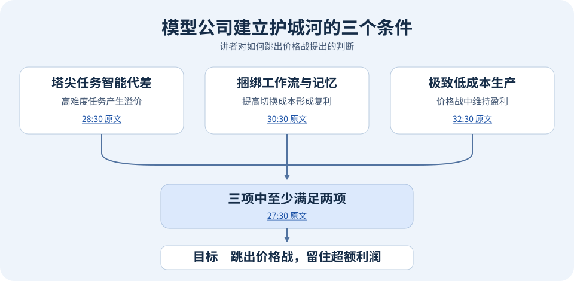

# 【LLM】终章：在不确定中求变 · 章内关系图版

与上一版使用同一份整集原始转写。正文为实际模型输出。图中将三项条件汇总到组合门槛，保留原文所说的「至少两项」。

## 核心判断：在不确定中求变的本质
本期作为 LLM 系列终章，回答了“在 AI 时代个人与企业应如何下注”的问题。讲者提出核心观点：**在不确定中求变，做自己擅长的事比追着别人跑更有胜算**。

讲者引用马化腾在腾讯内部讲话提到两点启发：一是业务要面向 AI 重新创业，二是资源有限需找准位置发挥优势。由此引出对“赌”字的理解——商业和人生的重大选择往往没有完美信息，必须面对不确定性。“维持原样”本身也是一种下注，赌的是过去的方法未来依然有效。因此，无论是 OpenAI 早期重注 Scaling Law，还是英伟达早年推 CUDA，都是在看不清未来时的主动下注。

## 样本复盘：三类公司的不同赌局
讲者将前九期聊过的 11 家模型公司分为三类，通过对比它们的战略选择，揭示不同处境下的生存逻辑：

### 1. 旧王（互联网巨头）
拥有庞大用户和现金流，但也背负组织包袱。
*   **谷歌**：赌从“信息分发”走向“行动分发”，守住需求第一站的位置。
*   **Meta**：赌用户愿意交出隐私换取更懂自己的 AI，利用其连接人的优势。
*   **阿里 vs 字节**：阿里侧重供给端，开放千问模型争取云计算收入；字节侧重需求端，通过豆包留住用户习惯再商业化。

### 2. 新贵（纯模型公司）
围绕模型生长，无大厂缓冲垫，必须证明 AI 本身能长成独立大生意。
*   **OpenAI**：相信规模效应（Scaling Law），敢下重注投入算力和资源，“大力出奇迹”。
*   **Anthropic (SRP)**：在规模基础上更进一步，认为更强智能承担更重要工作，客户愿持续付费。
*   **Kimi & 智谱**：面临融资依赖预期但需回报的压力，若无法自证盈利可能陷入庞氏骗局风险。

### 3. 跨界豪强
原有主业提供资源支持（Deep Pocket），且少历史包袱。
*   **DeepSeek**：走极致效率和开放共生路线，靠工程优化降低门槛，通过开源扩大影响力，但商业闭环仍待验证。
*   **Grok (xAI)**：马斯克视 AI 为战略资产，不惜亏损也要掌握自研能力，服务于火星移民等宏大愿景。
*   **英伟达（模型业务）**：像风投一样布局语言、世界、机器人等多方向模型并开源，旨在扩大计算需求以反哺硬件销售。

## 关键反思：旁观者的局限与反向木桶原理
听完案例后，讲者提醒听众警惕“纸上谈兵”。虽然战略总结看似简单，但决策者在执行时面临预算、技术路线选择、融资节奏等同时发生的复杂困难。**低估他人复杂性、高估自身能力是危险状态**。真正的收获应是意识到自己看不懂的差距，从而保持谦虚。

针对个人策略，讲者提出**反向木桶原理**：
1.  **做擅长的事**：避免在不擅长的领域硬拼。例如字节做视频生成顺理成章（有抖音/TikTok基础），而 OpenAI 做 Sora 则非其最擅长领域（其擅长搞钱和囤算力）。Sam Altman 停掉 Sora 转攻算力中心，正是回归舒适区。
2.  **长板足够长，短板不致命**：在 AI 辅助下，大部分短板可被弥补。关键在于建立极致的长板。例如 DeepSeek 的长板是开放中立，短板是企业服务；Anthropic 的长板是先进智能和企业服务，短板是不开放且昂贵。只要长板足以解决核心痛点（如替代科学家或处理复杂任务），短板便不是否决项。

## 行业深究：盈利困境与护城河三要素

[单独打开 SVG 关系图](relationship.svg)

讲者指出一个未解之谜：模型行业最终如何稳定盈利？目前存在“价值巨大但公司难留利润”的矛盾，类似航空业。

**现状数据支撑：**
*   **资本开支激增**：美股四大云厂商（亚马逊、谷歌、Meta、微软）今年资本开支超 7000 亿美元，两年翻近三倍。
*   **增收不增利**：以 Anthropic (SRP) 为例，前三季度收入 332 亿美元（同比涨 13 倍），但因算力等投入巨大，仍有 12.6 亿美元经营亏损。
*   **价格战压力**：顶级闭源模型 API 价格高昂（如 GPT-4o 输入 $10/百万 token），但受 DeepSeek、千问等开源模型低价（$0.3-$1.2/百万 token）冲击，利润空间被压缩至“夹心层”。

在此背景下，讲者提出模型公司若想跳出价格战、建立护城河，需至少满足以下三个条件中的两个：

1.  **绝对智能代差**：在最难的 10% 塔尖任务（如复杂架构、深度推理）上保持领先。此时 95 分与 80 分的差异不是价格，而是成败。谁能高效整合算力并在 Scaling Law 曲线上快半步，谁就能获得溢价。
2.  **系统绑定与切换成本**：从卖标准 API 转向捆绑工作环境、长期记忆的 Bundle。当模型深入企业权限审批、数据系统和日常流程，替换它不再是改代码，而是涉及安全审计和组织记忆迁移的高昂成本。这形成了随时间增长的复利护城河（如腾讯 Work Body、飞书正在做的尝试）。
3.  **极致生产成本**：在超大体量下，将每度电、每块芯片的有效产出成本压到全行业最低。若同等算力下有效智能产出是对手的 3-5 倍，或在电力成本上有优势，就能在价格战中存活并熬死对手（类似滴滴、Uber 早期的补贴战逻辑）。

目前尚无公司完全跑通这三点，商业模式仍在过渡期。

## 个人启示：拥抱不确定性
对于个体而言，上班族与创业者最大的区别在于对待不确定性的态度。芒格建议“反过来想”：如果某件事做法成熟、回报清晰，资源充足的大公司早已占满位置，普通人机会渺茫。

**普通人的机会藏在：**
*   **麻烦之中**：顶尖模型虽强大，但不了解具体行业的细微卡点和业务门道。外行看不懂、大公司看不起的琐碎流程，正是结合 AI 新能力进行创新的空间。
*   **先发优势**：不要等待答案被证明后才行动。在自己熟悉的领域先动手尝试，才能形成独有经验。

最后，讲者将问题留给听众：在你的工作或生活中，你正面对怎样的不确定性？你的赌局是什么？你准备如何从自己擅长的事开始下注？

## 图中关系的原文依据

- [28:30](https://www.xiaoyuzhoufm.com/episode/6afde79ea4a79edf137b6820#ld-position-ms=1710000) · 高难度任务产生溢价
- [30:30](https://www.xiaoyuzhoufm.com/episode/6afde79ea4a79edf137b6820#ld-position-ms=1830000) · 提高切换成本形成复利
- [32:30](https://www.xiaoyuzhoufm.com/episode/6afde79ea4a79edf137b6820#ld-position-ms=1950000) · 价格战中维持盈利
- [27:30](https://www.xiaoyuzhoufm.com/episode/6afde79ea4a79edf137b6820#ld-position-ms=1650000) · 需至少满足两条破局

## 正文原文引用位置

- [02:00–02:30](https://www.xiaoyuzhoufm.com/episode/6afde79ea4a79edf137b6820#ld-position-ms=120000)
- [04:00–04:30](https://www.xiaoyuzhoufm.com/episode/6afde79ea4a79edf137b6820#ld-position-ms=240000)
- [08:00–08:30](https://www.xiaoyuzhoufm.com/episode/6afde79ea4a79edf137b6820#ld-position-ms=480000)
- [14:30–15:00](https://www.xiaoyuzhoufm.com/episode/6afde79ea4a79edf137b6820#ld-position-ms=870000)
- [18:00–18:30](https://www.xiaoyuzhoufm.com/episode/6afde79ea4a79edf137b6820#ld-position-ms=1080000)
- [23:30–24:00](https://www.xiaoyuzhoufm.com/episode/6afde79ea4a79edf137b6820#ld-position-ms=1410000)
- [24:30–25:00](https://www.xiaoyuzhoufm.com/episode/6afde79ea4a79edf137b6820#ld-position-ms=1470000)
- [27:30–28:00](https://www.xiaoyuzhoufm.com/episode/6afde79ea4a79edf137b6820#ld-position-ms=1650000)
- [28:30–29:00](https://www.xiaoyuzhoufm.com/episode/6afde79ea4a79edf137b6820#ld-position-ms=1710000)
- [30:30–31:00](https://www.xiaoyuzhoufm.com/episode/6afde79ea4a79edf137b6820#ld-position-ms=1830000)
- [32:30–33:00](https://www.xiaoyuzhoufm.com/episode/6afde79ea4a79edf137b6820#ld-position-ms=1950000)
- [37:00–37:30](https://www.xiaoyuzhoufm.com/episode/6afde79ea4a79edf137b6820#ld-position-ms=2220000)
