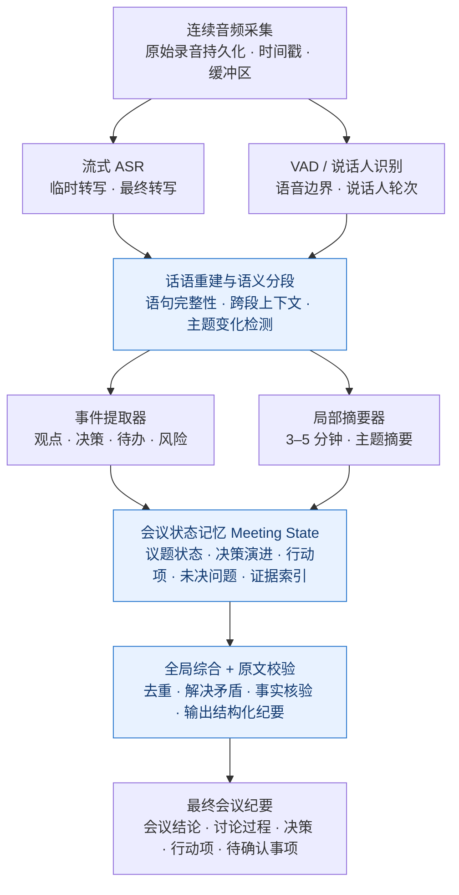
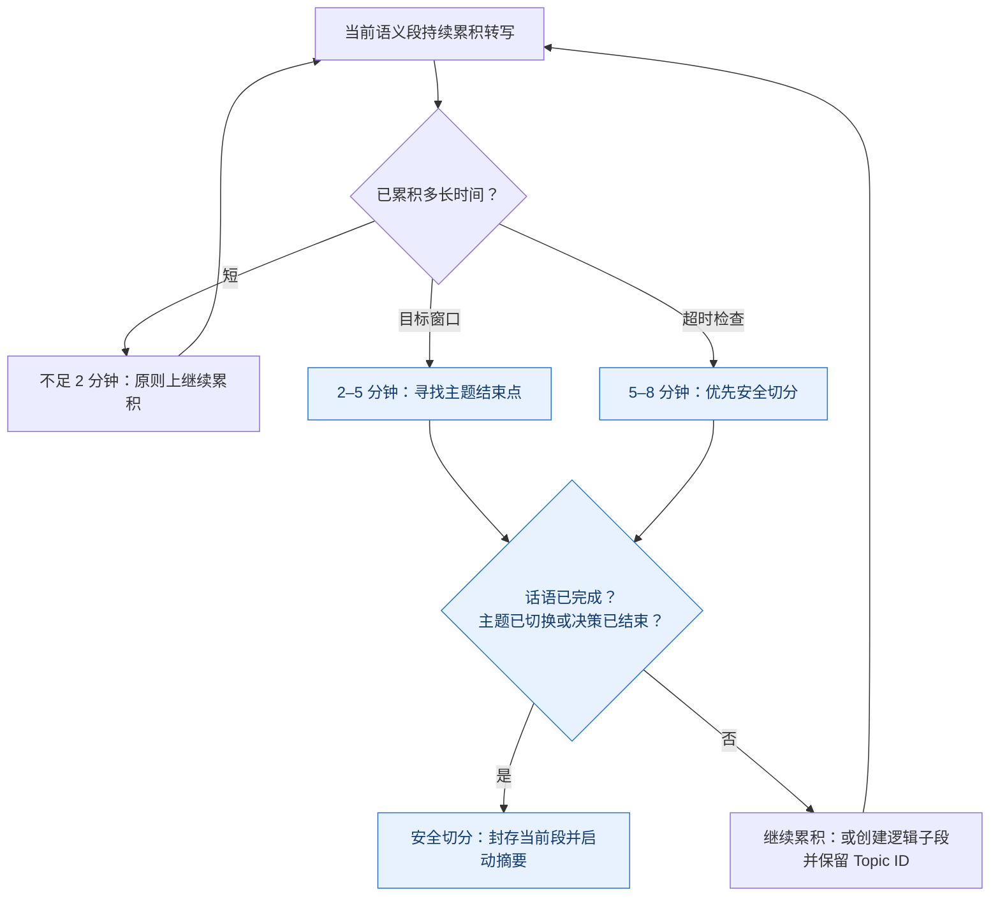
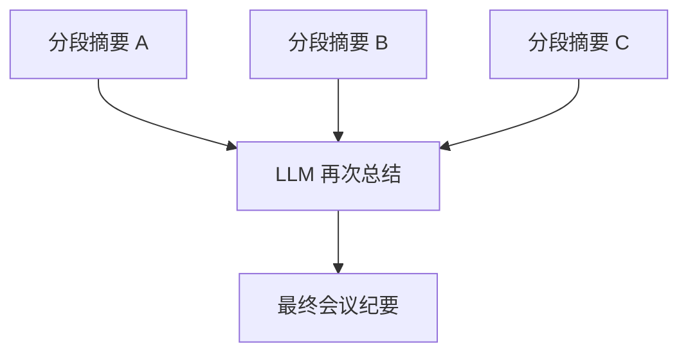
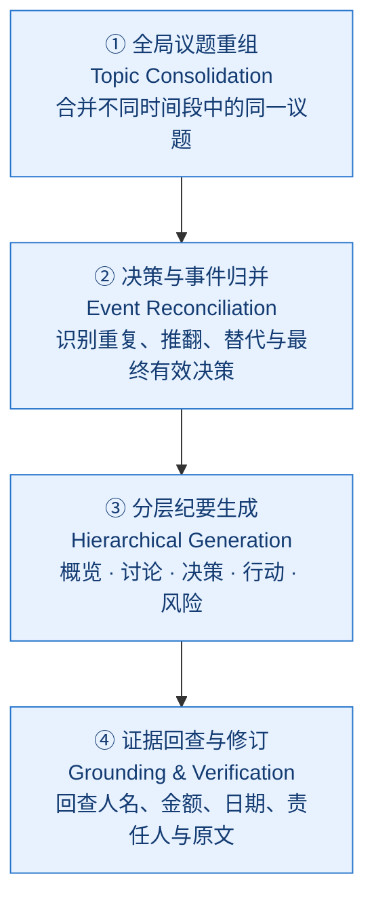
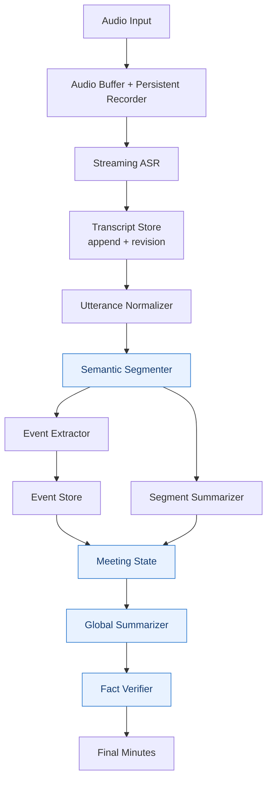

# 实时 AI 会议纪要系统：从音频采集到高质量总结的完整技术方案

> **文档主题：** 实时采集录制、语音转写、动态分段、增量摘要、全局纪要与证据校验  
> **版本：** 研究整理版 v1.0｜2026-11-08  
> **适用场景：** 线上会议、线下会议、通用会议助手  
> **说明：** 本文完整整理此前讨论的 12 个章节、流程图、参数表、示例及验证建议。图形采用 Mermaid，支持 GitHub 等兼容 Mermaid 的 Markdown 阅读器。所有参数均为待验证的工程初始值，不代表研究已证明的最优值。

我建议把这个问题当成一个 **实时语音理解与会议知识提炼系统（Streaming Meeting Intelligence）** 来研究，而不是简单的“录音 → 语音转文字 → 大模型总结”。

因为真正决定会议纪要质量的，不只是大模型能力，而是整条处理链路的设计：

1. **采集层**：如何持续录音、实时转写，避免丢失信息。
2. **分段层**：如何把连续讲话切分为语义完整的片段。
3. **理解层**：如何识别讨论主题、观点、决策、行动项。
4. **记忆层**：如何保留跨片段上下文，避免前后矛盾和信息遗失。
5. **总结层**：如何持续生成阶段总结，并在会议结束时形成完整纪要。
6. **校验层**：如何追溯总结中的结论，避免 AI 编造、误解或遗漏。

本文重点讨论 **分段时长、语句完整性、分段总结、全局总结、采样与总结策略**，并给出可用于实际开发的架构与参数建议。

**核心设计判断：不要采用“每隔 N 分钟截断音频，然后独立总结”的方案。**

> 音频连续采集，转写以语音边界为单位，语义分段以主题为单位，总结以事件和证据为单位，最终纪要以整场会议的决策演进为主线。

这几个层次应当使用不同的时间窗口和触发条件。

---

## 一、研究结论：采用多时间尺度的分层处理架构

从现有研究看，有几项结论值得作为架构设计依据。

- 2025 年关于实时会议摘要的研究采用了议程跟踪、增量摘要、历史记忆和最终摘要修订的组合，而非简单的固定时间切块。[研究论文](https://link.springer.com/article/10.1007/s44443-025-00304-y)。
- SIGDIAL 2021 的增量会议摘要研究发现，纳入历史上下文有助于改善摘要质量。[研究论文](https://aclanthology.org/2021.sigdial-1.55/)。
- 2025 年 ACL 的 MISP-Meeting 研究显示，语音识别质量与摘要连贯性密切相关。因此，不能把 ASR 视为一个无关紧要的前置模块。[研究论文](https://aclanthology.org/2025.acl-long.753/)。
- 2025 年 COLING 的研究表明，大模型会议摘要仍然存在遗漏、无关内容和幻觉问题，引入错误检测与修订可以改善结果。[研究论文](https://aclanthology.org/2025.coling-main.143/)。

这些研究支持分层、增量、可校验的架构，但并没有证明某一个固定分段时长在所有会议中都是最优的。

### 1.1 推荐的时间窗口

以下是我建议用于第一版 PoC 的 **工程初始参数**，不是论文已经验证的最优值。

| 层次 | 推荐窗口 | 触发机制 | 主要目的 |
|---|---|---|---|
| 音频采集 | 20–100ms 帧 | 持续 | 低延迟采集、缓冲 |
| ASR 输出 | 0.5–2 秒 | 流式更新 | 实时字幕 |
| 话语定稿 | 约 1–15 秒 | 停顿及语义完整性 | 完整发言 |
| 微批处理 | 30–60 秒 | 时间 + 稳定文本 | 纠错、事件提取 |
| 语义分段 | 3–5 分钟为目标 | 主题变化 + 长度 | 局部总结 |
| 阶段总结 | 10–15 分钟 | 主题完成或时间 | 累积阶段成果 |
| 全局总结 | 会议结束 | 全量信息校验 | 正式会议纪要 |

**这里最关键的是区分三个概念：**

- 话语切分：一句话什么时候说完？
- 语义切分：一个讨论单元什么时候结束？
- 摘要切分：什么时候值得调用 LLM 生成或更新摘要？

它们不应该共用一个定时器。

### 1.2 系统整体架构



我建议把它实现成一条持续运行的处理流水线，而不是让一个 Agent 从头到尾承担全部工作。Agent 或 LLM 负责语义理解、摘要和校验；音频采集、缓冲、切分、版本管理和任务调度由确定性程序负责。

---

## 二、语音采集与采样策略：怎样既实时又不丢信息？

这里要区分两种完全不同的“采样”：

**音频采样（Audio Sampling）** 是音频信号的采样率与编码；**内容采样（Content Sampling）** 是哪些转写内容需要进入 AI 的处理窗口。

### 2.1 音频采样策略

建议优先采用以下配置：

| 参数 | 推荐配置 | 原因 |
|---|---|---|
| 原始采集 | 48kHz，16-bit PCM | 适合常见设备采集与后续处理 |
| ASR 输入 | 16kHz 单声道 PCM（按模型要求调整） | 常见语音识别输入格式 |
| 音频帧 | 20–40ms | 便于流式处理 |
| 网络传输 | 100–200ms 聚合包 | 减少请求开销 |
| 原始音频存储 | 连续录音，分文件持久化 | 可回放、可重新识别 |
| 文件滚动 | 每 5 分钟左右 | 便于容错和恢复 |
| 时间戳 | 单调时钟 + 会议时间基准 | 防止时间漂移 |

48kHz 是建议的本地采集配置，并不意味着所有 ASR 模型都接受 48kHz。发送前应根据模型要求重采样。例如，部分 Realtime API 的 PCM 音频输入有特定采样率限制；不能假设 16kHz 或 48kHz 可直接用于所有服务。

另外，**存储文件滚动不等于语义分段**。即使每 5 分钟保存一个录音文件，也不应该在文件边界截断说话内容。

对于线上会议，如果系统允许，优先分别采集本地麦克风和远端系统音频；对于线下多人会议，尽可能保留多声道或独立麦克风信息。这对后续说话人识别和串音处理很有价值。

### 2.2 使用 VAD，但不要把 VAD 当作完整句子识别器

VAD（Voice Activity Detection）负责检测声音活动及静音边界。

例如：

> “我觉得这个项目……（停顿 0.8 秒）……可以先做一个小程序验证。”

如果系统将 0.8 秒的停顿直接认定为一句话结束，后续摘要就可能拿到两个不完整的片段。

OpenAI 的实时 API 文档区分了基于静音的 `server_vad` 和结合语义判断发言是否结束的 `semantic_vad`，说明单纯静音检测与语义完整性检测确实是不同的问题。**不同转写模型对这些模式的支持不同**，例如文档提示某些 Realtime 转写模型须关闭服务端 turn detection。[官方文档](https://developers.openai.com/api/docs/guides/realtime-vad)。

我建议第一版采用双层边界判断：

- **声学层**：约 500–800ms 静音作为候选结束信号。
- **语义层**：判断当前发言是否已经形成完整意思；若尚未完成，则等待后续内容。
- **保护层**：持续发言达到 15–20 秒时允许产生中间话语单元，但保持可拼接状态。

这些阈值应针对中文会议录音进行测试，尤其是口头禅较多、停顿较长、多人抢话的情况。

### 2.3 实时转写必须支持两种状态

> **临时文本（Partial）· 可变**  
> 00:12:08 · 发言人 A  
> “我们下周可能先把用户端的……”
>
> **定稿文本（Finalized）· 稳定**  
> 00:12:08–00:12:16 · 发言人 A  
> “我们下周先把用户端的登录和课程列表做出来，支付功能暂时不做。”

临时文本用于实时字幕和交互展示，定稿文本才进入正式语义处理。

原因是流式 ASR 可能不断修改前面的识别结果。如果将临时文本直接加入摘要，就可能出现重复计算、错误结论以及版本混乱。

但还需要注意：ASR 标记为 Final，并不代表识别内容一定正确。系统应该允许后续纠错，并通过版本号触发受影响的摘要重新计算。

---

## 三、分段策略：到底多少分钟一段最合理？

这是整个系统的第一个核心设计点。

我建议：**以 3–5 分钟作为语义段目标区间，2 分钟作为常规最小长度参考，8 分钟作为强制检查上限。**

不是 5 分钟到点立即切断，而是进入一个允许寻找合适边界的窗口。

### 3.1 三种分段方案对比

| 策略 | 优点 | 问题 | 建议 |
|---|---|---|---|
| 固定时间分段 | 简单、可预测 | 容易截断语义 | 仅作为基线 |
| 纯语义分段 | 主题完整 | 段长不可控、延迟不稳定 | 不宜单独使用 |
| 时间 + 语义混合 | 平衡完整性、延迟和成本 | 实现稍复杂 | **推荐** |

### 3.2 推荐的分段决策逻辑



如果 8 分钟仍在持续讨论同一议题，不应为了凑时间把议题标记为结束。可以将其拆为多个**逻辑子段**，共同指向同一个 Topic ID。

如果一个议题在 90 秒内明确结束，也应允许提前切分。因此 2 分钟不是硬性下限。

### 3.3 语义边界应该看什么？

建议至少使用以下信号：

| 信号 | 示例 | 重要程度 |
|---|---|---|
| 明确切换议题 | “接下来讨论支付” | 高 |
| 讨论达成结论 | “那就这么定了” | 高 |
| 话题语义变化 | 从需求讨论转为报价 | 高 |
| 发言轮次变化 | A 说完换 B | 低 |
| 明显长停顿 | 全场静音 3 秒 | 中 |
| 时间达到上限 | 已持续 8 分钟 | 兜底 |

尤其需要避免：**把说话人变化直接等同于主题变化。** 多人讨论时，一个议题可能持续几十轮对话。

对于更复杂的版本，可以结合文本 Embedding 相似度、话题分类器和 LLM 边界判断。会议主题分段实践还要注意：简短附和、口语噪声以及信息密度不均会干扰传统分段方法。

### 3.4 交互实验：感受分段时长的差异

以 60 分钟会议为例，目标分段长度为 2–10 分钟时，摘要任务数量大致如下：

| 目标分段 | 估计分段数 | 每段摘要调用次数（不含重试） | 典型影响 |
|---|---:|---:|---|
| 2 分钟 | 30 | 30 | 更新更快，但碎片化严重 |
| 3 分钟 | 20 | 20 | 粒度较细，跨段合并较多 |
| 5 分钟 | 12 | 12 | **建议优先验证**，平衡语义完整性与成本 |
| 8 分钟 | 8 | 8 | 延迟更长，一段中可能有多个议题 |
| 10 分钟 | 6 | 6 | 调用更少，但摘要负担较重 |

**估算公式：** `段数 = ceil(会议总时长 / 目标分段分钟数)`。

> 注意：仅用于容量估算。真实系统采用动态语义切分，实际段数不会严格等于会议时长除以目标时长。配套 HTML 页面保留了可操作的分段时长滑块。

---

## 四、语句完整性：如何避免断句导致 AI 理解错误？

比分钟数更重要的是 **完整话语重建（Utterance Reconstruction）**。

会议中的讲话通常不是书面语。一个人可能反复修正自己的表达：

> “这个项目我们先做支付……不对，支付先不做，先把课程展示和预约流程跑通，支付等第二期。”

如果只截取前半段，AI 可能生成一个完全错误的行动项：“第一期完成支付”。

### 4.1 建议建立三层文本表示

| 层次 | 内容 | 用途 |
|---|---|---|
| Raw Transcript | ASR 原始输出 | 审计、纠错 |
| Normalized Transcript | 标点、断句、术语修正 | 检索、阅读 |
| Semantic Units | 重建后的完整观点 | 事件提取与总结 |

这里有一个重要原则：

**语句整理可以改善可读性，但不能悄悄修改原意。**

比如可以去掉无意义的“嗯、啊”，但不能删除“不是、暂时不、可能、需要再确认”这样的关键限定词。

### 4.2 语句重建使用滚动上下文

每当获得一批新的稳定转写，可以让语句整理模块看到：

- 前面约 2–3 个已完成话语单元；
- 当前尚未完成的发言；
- 最新 1–2 个话语单元；
- 说话人、时间戳和原始文本位置。

不必每次都重新处理整场会议。

对于语义分段的边界，可以保留约 20–40 秒上下文供下一段理解，但这些重叠内容只作为上下文，不再次计入事件提取和摘要。

### 4.3 采用“所有权 + 上下文”机制避免重复

假设在 04:55 处切分：

- Segment A 拥有 00:00–04:55 的正式内容。
- Segment B 拥有 04:55 之后的正式内容。
- Segment B 可以读取 Segment A 末尾的上下文。

每个话语单元只有一个正式归属段。跨段关联通过 `utterance_id` 和 `topic_id` 表达。

这样既能保留上下文，又不会因为窗口重叠而重复生成决策或行动项。

---

## 五、分段总结：不要直接把一段转写压缩成一段文字

这是第二个核心设计点。

我的建议是采用：

**事实与事件提取（Extract）→ 结构化更新（Update）→ 局部摘要（Summarize）**

而不是每 5 分钟直接让大模型“总结以下会议内容”。

### 5.1 先提取事件，再生成摘要

每个语义段需要识别以下信息：

| 事件类型 | 示例 |
|---|---|
| Topic | 讨论后台管理功能 |
| Proposal | 建议第一期只做课程 CRUD |
| Concern | 担心支付接入增加交付周期 |
| Decision | 第一阶段暂不接入支付 |
| Action | 开发人员提供接口设计 |
| Open Question | 支付是否需要第二期上线 |
| Correction | 原先计划本周交付，改为下周 |
| Evidence | 对应原文及时间戳 |

其中 `Proposal` 和 `Decision` 必须严格区分。

例如“我建议先不上支付”只是提议，不代表团队已经决定不上支付。

### 5.2 推荐的数据结构

```json
{
  "segment_id": "seg_003",
  "start_ms": 600000,
  "end_ms": 895000,
  "topic_id": "topic_payment",
  "summary": "讨论第一期支付功能范围",
  "events": [
    {
      "event_id": "evt_021",
      "type": "decision",
      "content": "第一期暂不接入支付",
      "status": "confirmed",
      "speaker_id": "speaker_A",
      "evidence_utterance_ids": ["utt_120", "utt_126"]
    }
  ],
  "open_questions": [
    {
      "content": "第二期是否接入微信支付",
      "status": "unresolved"
    }
  ]
}
```

这里的 `confirmed` 代表有足够明确的会议证据，而不是模型自认为置信度很高。

实际系统还应该保留：

- `extractor_version`：事件提取器版本。
- `transcript_revision`：对应转写版本。
- `supersedes_event_id`：被后续结论替代的事件。
- `speaker_confidence`：说话人识别可靠性。
- `review_required`：是否需要人工核实。

### 5.3 分段摘要应该输出什么？

我建议分段摘要尽量简短，通常为 100–250 个汉字左右，但不设置硬性上限；重要决策可以更详细。

> **Segment 03 · 支付功能讨论（10:00–14:55）**  
> **讨论概况：** 团队讨论了第一期是否接入微信支付。主要担忧是支付流程增加接口、测试和验收成本，影响当前交付周期。  
> **已确认决策：** 第一阶段暂不接入支付，优先完成课程展示与预约流程。  
> **待确认事项：** 第二期支付方式和上线时间尚未确定。  
> **后续行动：** 产品负责人整理第一期功能边界，并与甲方再次确认。  
> **证据：** 每条决策和行动项均应关联原始发言及时间戳。以上为示例数据。

这类结构化摘要比单纯自然语言段落更适合后续增量合并。

---

## 六、阶段总结：如何把多个分段组合成连贯的讨论？

每 10–15 分钟可以执行一次阶段性综合，但 **不建议简单地把三个分段摘要拼接起来再摘要一次**。

原因在于：会议讨论是一个持续变化的过程。

例如：

- 第 3 分钟：建议第一期做支付。
- 第 8 分钟：开发认为成本过高。
- 第 12 分钟：提出使用第三方支付。
- 第 18 分钟：最终决定第一期不做支付。

如果每段都独立总结，最终可能出现四个相互冲突的结论。

### 6.1 使用可更新的会议状态

我建议维护一个独立的 `Meeting State`：

```text
Meeting State
├── Topics
│   ├── 当前议题
│   ├── 已完成议题
│   └── 重新打开的议题
├── Decisions
│   ├── 已确认
│   ├── 暂定
│   ├── 被替代
│   └── 已撤销
├── Action Items
│   ├── 负责人
│   ├── 截止时间
│   └── 执行状态
├── Open Questions
├── Risks
└── Evidence Index
```

新的分段不直接覆盖旧摘要，而是产生状态更新操作，例如：

- `ADD_DECISION`
- `SUPERSEDE_DECISION`
- `REOPEN_TOPIC`
- `RESOLVE_QUESTION`
- `UPDATE_ACTION`

这样就能记录一个决策从提出、讨论到最终确定的全过程。

### 6.2 阶段总结采用增量更新

每次阶段总结输入：

1. 上一版 Meeting State；
2. 最近新增的结构化事件；
3. 本阶段相关的原始发言；
4. 会议议程或项目背景（如果有）。

输出新的状态版本和阶段性摘要。

可表示为：

$$
M_t = \operatorname{Update}(M_{t-1}, E_t, C_t)
$$

其中：

- `M_t`：当前会议状态；
- `E_t`：新增事件；
- `C_t`：相关上下文和原始证据。

这种方式可以控制上下文长度，同时避免反复总结导致的信息损失。

需要特别强调：**Meeting State 是工作记忆，不是事实的唯一来源。** 原始音频、稳定转写和事件证据仍然是最终校验依据。

---

## 七、最终总结：如何生成高质量的整场会议纪要？

我不建议使用最简单的 Map-Reduce Summarization：



这种方法适合一般文章摘要，但对会议纪要存在明显风险：早期分段摘要遗漏的信息无法恢复；反复压缩会丢失细节；跨段发生的决策变化也容易被误判。

更推荐采用 **Hierarchical Summarization + Event Sourcing + Evidence Verification**，即分层摘要、事件溯源与证据校验相结合。

### 7.1 最终总结的四个阶段



**1. 全局议题重组（Topic Consolidation）**

不按照录音的时间顺序简单拼接，而是把同一主题在不同时间段的讨论聚合起来。比如第 5 分钟和第 45 分钟都讨论支付功能，应当关联到同一个议题。

**2. 决策与事件归并（Event Reconciliation）**

识别重复事件、观点变化、被推翻的决定和最终有效结论。不能把某个提议误写为最终决策。

**3. 分层纪要生成（Hierarchical Generation）**

根据议题和事件生成会议概览、讨论要点、最终决策、行动项、风险和待确认事项。不同内容使用不同详细程度。

**4. 证据回查与修订（Grounding & Verification）**

将关键结论逐条映射到原始转写，核对人名、金额、日期、责任人、否定词和最终决策状态。无法确认的内容应标记待核实，而不是猜测。

这与微软研究中提出的“重要内容摘要 + 分层结构化纪要”两种互补呈现形式有相似思路。[微软研究](https://www.microsoft.com/en-us/research/publication/summaries-highlights-and-action-items-design-implementation-and-evaluation-of-an-llm-powered-meeting-recap-system/)。

### 7.2 最终会议纪要建议采用双层结构

**第一层：管理层摘要（Executive Summary）**

面向只想用 1–2 分钟了解会议结果的人，包含会议目的、核心结论、关键决策和最重要的下一步行动。

**第二层：完整会议纪要（Detailed Minutes）**

面向参与者和项目执行者，包含各议题的背景、主要观点、分歧、决策演进、待办、风险及证据引用。

不建议要求 LLM 无论会议内容多少，都必须输出固定 500 字或 1000 字。应当根据 **有效信息密度** 动态调整输出长度。

例如，一场 60 分钟的会议可能只有三个重要结论，也可能包含十几个决策和二十个行动项。二者不应该使用同样的摘要预算。

---

## 八、内容采样策略：哪些内容应该送给 AI？

这部分容易被忽略，但直接影响成本和摘要质量。

我建议区分三个层级。

| 处理层 | 内容采样方式 | 信息保留 |
|---|---|---|
| 原始转写 | 全量保留 | 100%，不主动丢弃 |
| 事件提取 | 全量稳定话语逐批处理 | 所有片段都有机会被识别 |
| 阶段及最终摘要 | 重要事件 + 相关原文检索 | 按信息价值分配上下文 |

也就是说，**不要为了降低 Token 消耗，在输入阶段随机丢掉 30% 或 50% 的会议内容。**

### 8.1 按事件价值分配处理资源

可以建立事件优先级：

| 事件 | 优先级 | 处理方式 |
|---|---|---|
| 已确认决策 | P0 | 必须提取、保留原文、最终核验 |
| 行动项、负责人、截止日期 | P0 | 必须提取、逐项核验 |
| 金额、报价、合同条件 | P0 | 保留精确原文及时间戳 |
| 关键分歧、风险 | P1 | 保留上下文与主要论据 |
| 方案建议、重要问题 | P1 | 保留事件及状态 |
| 一般讨论与背景 | P2 | 可以压缩 |
| 寒暄、重复、无意义附和 | P3 | 摘要可忽略，原文仍保留 |

重要性可以辅助排序，但不应该只靠一个简单分数决定是否删除内容。

尤其是一个原本不重要的观点，可能在 30 分钟后成为最终决策的关键依据。

### 8.2 事件驱动优于纯时间驱动

推荐采用混合触发：

- **时间触发**：每 30–60 秒运行一次微批处理，避免长时间没有输出。
- **事件触发**：检测到明确决策、任务分配、议题结束时，优先更新结构化状态。
- **上下文触发**：当某议题累积信息较多时，生成阶段摘要。
- **结束触发**：会议结束后，进行全局重组与校验。

这样的系统既能提供实时反馈，也能控制成本。

---

## 九、实际开发时，应该用几个 AI Agent？

我的建议是：**不要一开始就使用多个自治 Agent 相互对话。**

对这个场景，更适合一个确定性编排器管理多个专用 AI 处理任务。

| 模块 | 是否需要 LLM | 主要职责 |
|---|---|---|
| Audio Collector | 否 | 连续录音、时间戳、容错 |
| Streaming ASR | 语音模型 | 实时转写 |
| Utterance Normalizer | 可选小模型 | 断句、纠错、规范化 |
| Segmenter | 规则 + 小模型 | 语义分段 |
| Event Extractor | 是 | 提取结构化事件 |
| State Manager | 规则为主 | 事件合并、版本管理 |
| Segment Summarizer | 是 | 局部摘要 |
| Global Summarizer | 是 | 整场纪要 |
| Verifier | 是 + 规则 | 证据核查 |

其中 Event Extractor、Segment Summarizer 和 Global Summarizer 完全可以共用同一个 LLM，只使用不同的 Prompt、Schema 和上下文。

第一版不需要九个独立 Agent，也不需要引入复杂的多智能体框架。

### 9.1 推荐的系统技术架构



建议采用事件驱动的异步任务架构，让 ASR 不必等待 LLM 总结完成。

还需要加入以下工程机制：

- 每个处理任务拥有唯一 ID，支持幂等重试。
- 每个摘要记录所依赖的转写版本。
- ASR 修订时，只重新计算受影响的片段。
- 会议中断或服务重启后，可以从最后的稳定转写恢复。
- 录音与转写数据加密保存，并支持保留期限与删除策略。
- 录制前确保满足参会者告知、同意和适用法律要求。

---

## 十、如何验证这些策略到底有没有效果？

这部分我认为非常重要。

我们不能仅仅因为某个分段策略听起来合理，就认定它效果最好。应该用真实会议数据进行对照实验。

### 10.1 建议先比较四组策略

| 实验组 | 分段策略 | 总结策略 |
|---|---|---|
| A（基线） | 固定 5 分钟 | 分段摘要直接合并 |
| B | 动态语义分段 | 分段摘要直接合并 |
| C | 动态语义分段 | 结构化事件 + 增量状态 |
| D | 动态语义分段 | 结构化事件 + 增量状态 + 最终原文校验 |

我预期 C、D 的决策追踪和事实完整性会更好，但这属于需要通过实验验证的假设，不能直接当成结果。

### 10.2 核心评估指标

| 指标 | 衡量内容 | PoC 建议目标 |
|---|---|---|
| 决策召回率 | 人工标注的关键决策有多少被找出 | ≥95% |
| 行动项召回率 | 任务是否遗漏 | ≥95% |
| 关键事实准确率 | 人名、金额、日期等是否正确 | ≥98% |
| 无证据断言率 | 无法从原文支持的事实比例 | ≤2% |
| 主题边界质量 | 分段是否合理 | 人工评分 |
| 实时摘要延迟 | 分段结束到摘要可用 | P95 ≤15 秒 |
| 最终纪要延迟 | 会议结束到生成纪要 | 目标 ≤60 秒 |

以上是建议的产品验收目标，不是现有系统已经达到的性能。

测试时还需要把 ASR 错误与摘要错误分开评估。例如，原始录音说的是“十五万”，ASR 识别为“五十万”，最终摘要沿用错误数字，根因首先是转写，而不完全是摘要器。

### 10.3 设计一套覆盖真实问题的测试语料

建议第一轮收集 10–20 场经过授权的会议，覆盖需求讨论、方案评审、客户沟通、项目例会、多人争论和长时间单人发言。

重点构造以下测试场景：

- 讲话在固定时间边界被截断。
- 同一个议题在会议中反复出现。
- 先提出方案，后续又否决。
- 参会者用模糊语言表达意向。
- 任务分配没有明确负责人。
- 会议最后一分钟突然改变关键决策。
- ASR 对专有名词、金额、数字识别错误。

这些比只看摘要是否流畅更能判断系统是否真正可用。

---

## 十一、推荐的 PoC 参数配置

我把前面的研究结论整理成一个可以直接用于开发实验的参数表。

### Meeting Intelligence · PoC v0.1

| 参数 | 初始值 |
|---|---|
| VAD 候选静音阈值 | 700ms |
| ASR 稳定文本处理 | 事件驱动 |
| 微批处理间隔 | 45 秒 |
| 目标语义段 | 5 分钟 |
| 常规最小语义段 | 2 分钟 |
| 语义段检查上限 | 8 分钟 |
| 跨段上下文 | 30 秒 |
| 阶段总结间隔 | 15 分钟 |
| 最终总结策略 | 议题聚合 + 事件归并 + 证据校验 |

以上参数用于第一轮基线实验。建议保留可配置能力，并通过实际会议样本调整。

---

## 十二、我的最终架构建议

对于希望开发的实时会议纪要能力，我会将设计重点放在三个核心机制上。

**第一，完整转写优先于实时总结。** 实时字幕可以不完美，但原始录音必须可追溯，稳定转写必须可修订。所有后续理解都建立在这个基础上。

**第二，事件状态优先于摘要文本。** 系统真正需要记住的不是每五分钟写出的一段漂亮文字，而是会议正在讨论什么、提出了哪些方案、做出了什么决定、哪些决定被推翻、还有什么需要执行。

**第三，最终综合必须能够回到原始证据。** 最终纪要不是把若干摘要再次压缩，而是利用议题结构和事件状态重新组织内容，并对关键事实进行回查。

如果只允许优先实现一个差异化能力，我会选择 **“决策演进追踪 + 原文证据定位”**。它比普通 AI 会议纪要更难实现，但也更有实际价值。

### 12.1 参考研究与技术资料

- [OpenAI — Voice Activity Detection](https://developers.openai.com/api/docs/guides/realtime-vad)：声学与语义话语边界，以及不同模型的支持限制。
- [Dynamic Agenda-Aware Real-Time Meeting Summarization（2025）](https://link.springer.com/article/10.1007/s44443-025-00304-y)：增量会议摘要与议程记忆。
- [Incremental Temporal Summarization in Multi-party Meetings（SIGDIAL 2021）](https://aclanthology.org/2021.sigdial-1.55/)：增量生成中保留历史上下文的价值。
- [MISP-Meeting（ACL 2025）](https://aclanthology.org/2025.acl-long.753/)：真实会议语音识别与摘要质量。
- [MeetingBank（ACL Findings 2023）](https://aclanthology.org/2023.findings-acl.377.pdf)：主题分段、多粒度摘要和关键语句提取。
- [What's Wrong? Refining Meeting Summaries with LLM Feedback（COLING 2025）](https://aclanthology.org/2025.coling-main.143/)：会议摘要错误识别与修订。
- [Summaries, Highlights, and Action Items（Microsoft Research）](https://www.microsoft.com/en-us/research/publication/summaries-highlights-and-action-items-design-implementation-and-evaluation-of-an-llm-powered-meeting-recap-system/)：重要内容摘要与层级化会议纪要的互补设计。

---

## 接下来最值得明确的一个产品问题

你希望这个实时会议纪要系统主要服务于哪种场景？

| 场景 | 关键技术重点 |
|---|---|
| 线下会议录音 | 单台设备采集多人讲话；说话人识别、噪声和语义完整性 |
| 线上会议采集 | 电脑系统音频或会议软件音频；多音轨、低延迟与会议上下文 |
| **通用会议助手（推荐）** | 兼顾线上和线下；形成可复用的会议智能处理引擎 |

场景确定后，可以进一步把这套研究转成可开发的 **技术设计文档（Technical Design）**，包括状态机、完整数据 Schema、分段算法、Prompt 模板、异步任务编排和测试用例。

> **导出说明：** 本文件中的 Mermaid 流程图可在 GitHub、Obsidian 或支持 Mermaid 的 Markdown 渲染器中显示。若阅读器不支持 Mermaid，仍可查看图形的源代码。配套 HTML 文件将图形内嵌为 SVG，可离线直接查看，并保留交互式分段估算、参数复制与场景选择。
