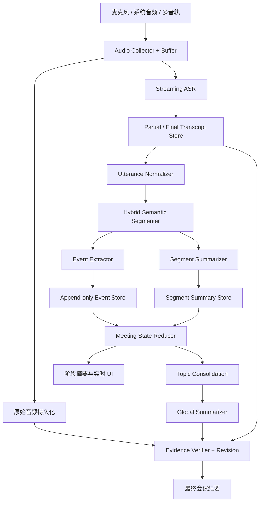

# 实时 AI 会议纪要引擎——完整技术方案

> **版本**：v1.0  
> **日期**：2026-11-08  
> **状态**：技术调研与 PoC 设计稿（参数待实测）  
> **适用场景**：线上会议、线下多人会议、混合会议；中文会议优先，架构支持多语言扩展。  
> **设计原则**：完整采集、稳定转写、语义分段、事件驱动、增量记忆、证据可追溯、最终全局核验。

---

## 目录

1. [执行摘要与核心结论](#1-执行摘要与核心结论)
2. [目标、边界和核心术语](#2-目标边界和核心术语)
3. [系统总体架构](#3-系统总体架构)
4. [音频采集与音频采样策略](#4-音频采集与音频采样策略)
5. [流式 ASR、VAD 与话语重建](#5-流式-asrvad-与话语重建)
6. [语义分段策略：多少分钟一段](#6-语义分段策略多少分钟一段)
7. [内容采样与上下文选择](#7-内容采样与上下文选择)
8. [结构化事件提取与局部总结](#8-结构化事件提取与局部总结)
9. [增量会议记忆与阶段总结](#9-增量会议记忆与阶段总结)
10. [整场会议纪要的生成与验证](#10-整场会议纪要的生成与验证)
11. [数据模型、状态机与接口契约](#11-数据模型状态机与接口契约)
12. [处理调度、故障恢复与成本控制](#12-处理调度故障恢复与成本控制)
13. [模型任务划分与 Prompt 模板](#13-模型任务划分与-prompt-模板)
14. [PoC 实验设计与验收指标](#14-poc-实验设计与验收指标)
15. [推荐默认配置与伪代码](#15-推荐默认配置与伪代码)
16. [实施路线图与风险清单](#16-实施路线图与风险清单)
17. [参考资料及证据边界](#17-参考资料及证据边界)

---

## 1. 执行摘要与核心结论

**不要做“固定每 N 分钟切一段录音，然后独立摘要，最后把摘要再次摘要”这样单层流水线。**

它容易在五个地方失败：

1. **截断语义**：时间到点时说话尚未结束，“先做支付……不对，先不做支付”可能被截成相反的两段。
2. **丢失决策演进**：前段是提议，中段是争议，后段才是结论；独立摘要不天然知道哪个状态最终有效。
3. **摘要递归失真**：早期摘要省略的细节在后面的“摘要的摘要”中无法自然恢复。
4. **重复与冲突**：上下文窗口重叠、转写修订、多次提及同一事项，可能使行动项被重复计算。
5. **缺少证据**：产生一份流畅的纪要，不代表每条决策、负责人和期限都能从录音中得到支持。

### 1.1 推荐方案

采用六条互相配合的设计原则：

- **音频连续采集**：录音持久化与文本摘要解耦，确保事后可以回放与重识别。
- **流式稳定转写**：显示用 `partial`，正式语义处理使用 `finalized`，且允许版本修订。
- **时间 × 语义混合分段**：建议以 **3–5 分钟**为目标语义段，2 分钟为常规长度参考，8 分钟为强制检查点；议题短则早切，议题长则保留同一 Topic ID 的子段。
- **先事实后表达**：先提取议题、提议、争议、决策、行动项、风险和修正事件，再生成自然语言摘要。
- **增量状态而非反复压缩**：维护具有版本和证据引用的 `Meeting State`，跟踪决策变化。
- **结束后全局综合与逐项验证**：按议题重组，核查重点事实，输出管理层摘要和完整纪要。

### 1.2 PoC 建议时窗（不是学术最优值）

| 层级 | 建议起始参数 | 目的 | 备注 |
|---|---:|---|---|
| 音频帧 | 20–40 ms | 流式采集 | 采样率依设备和 ASR 而定 |
| ASR 更新 | 约 0.5–2 s | 实时字幕 | 由提供方事件行为决定，不强行定时 |
| VAD 候选静音 | 约 500–800 ms，初始 700 ms | 候选话语边界 | **不是**最终语义边界 |
| 微批处理 | 30–60 s，初始 45 s | 文本整理、事件提取 | 可被重要事件提前触发 |
| 语义段目标 | 3–5 min | 局部总结 | 动态寻找安全边界 |
| 语义段检查上限 | 8 min | 保护上下文规模 | 允许同议题逻辑子段 |
| 跨段理解上下文 | 20–40 s，初始 30 s | 避免语义断裂 | 只读上下文，不能重复归属 |
| 阶段总结 | 10–15 min，初始 15 min | 增量会议状态 | 议题完成可提前触发 |
| 最终总结 | 会议结束后 | 全局重组和校验 | 延迟目标需实测 |

**强调**：这些是工程假设和第一轮 AB 实验的参数，而非已经证明的统一最优配置。

---

## 2. 目标、边界和核心术语

### 2.1 产品目标

系统应支持以下输出：

- 实时可读的逐字稿（包含说话人、时间戳、正在识别状态）；
- 随会议推进更新的主题列表、阶段概览、已决事项、未决问题、行动项；
- 会议结束后的完整结构化纪要和简短管理层摘要；
- 点击结论能定位到原文时间和音频片段；
- 会后修订逐字稿或负责人之后，对受影响内容可重计算、可追踪版本。

### 2.2 非目标（初始版本）

- 不承诺在嘈杂、多人重叠发言条件下实现 100% 说话人识别正确率；
- 不根据模型推测补全未明确确认的责任人、期限、预算或决策；
- 不把实时草稿当成正式会议决定；
- 不在未获得适当告知与许可的情况下隐蔽录音；
- 不把“多 Agent 自治对话”作为必要前提。

### 2.3 基本术语

| 术语 | 含义 | 是否等于时间片 |
|---|---|---|
| Audio Frame | 声学数据帧 | 否；流式基础单元 |
| Speech Turn | 一次连续发言轮次 | 否 |
| Utterance | 经过重建的一条相对完整话语 | 否 |
| Micro-batch | 触发轻量语义处理的稳定文本批次 | 可按时间累积 |
| Semantic Segment | 有明确归属范围的讨论单元 | 动态长度 |
| Topic | 同一个业务议题，可跨多个 Segment | 否 |
| Event | 提议、决策、行动、风险、修正等结构化事实 | 否 |
| Meeting State | 会议到当前时刻的可更新结构化记忆 | 否 |
| Evidence Span | 支持某个断言的原文或音频范围 | 否 |
| Final Minutes | 经全局综合和校验的正式纪要 | 否 |

---

## 3. 系统总体架构



### 3.1 架构分工

**确定性软件承担**：音频缓冲、时间基准、持久化、消息队列、状态机、版本管理、幂等处理、索引、权限、回放。  
**ASR/语音模型承担**：识别文字、可选说话人分离、时间对齐。  
**LLM 承担**：话语语义整理、话题转换判断、事件提取、摘要生成、歧义标记、证据验证。

推荐用**单一编排器 + 多个专项处理器**，而不是一开始就建设多个自治 Agent。LLM 角色可以共用一个模型，通过不同 Prompt、Schema 和工作流分工。

### 3.2 四种数据必须分开存放

1. **原始音频**：事实源之一，便于重新识别。
2. **逐字稿**：包含 ASR 原文、归一化文本、时间戳、说话人、修订版本。
3. **结构化事件**：逐步构建会议语义，保留证据来源。
4. **用户可见摘要**：属于派生视图，可被重算和修订。

任何摘要都不能反向覆盖原始录音或原始转写。

---

## 4. 音频采集与音频采样策略

### 4.1 区分“音频采样”与“内容采样”

- **音频采样 Audio Sampling**：采样率、量化位数、声道、帧长、编码、传输包。
- **内容采样 Content Selection**：哪些转写进入哪些摘要调用、保留多少上下文、对哪些事件投入更多校验资源。

不能因为需要节省 LLM Token，就随机抛弃音频或转写内容。

### 4.2 本地采集建议

| 参数 | 默认建议 | 适用说明 |
|---|---|---|
| 采集采样率 | 48 kHz | 本地设备层常见高质量配置，非强制 |
| 采集量化 | PCM16 | 简洁、兼容；设备可先采更高位深后转换 |
| 声道 | 尽量保留源声道 | 多人场景或系统/麦克风分轨有价值 |
| 音频帧 | 20–40 ms | VAD、流式管线的基础单元 |
| 上行聚合包 | 100–200 ms | 在延迟和调用开销之间平衡 |
| 持久化文件 | 约 5 min 滚动 | 便于故障恢复，**不是**语义分段 |
| 时间基准 | monotonic clock + 会话起始墙上时钟 | 保证顺序与展示时间一致 |
| ASR 采样率 | 严格依提供方接口 | 可能是 16 kHz，也可能需要 24 kHz 等 |

**重要接口注意**：部分实时接口要求特定音频格式。例如 OpenAI Realtime 的一些 PCM 接口文档规定 24 kHz；不能直接假设所有服务都接受 16 kHz。采集侧可保留 48 kHz 原始音频，向具体 ASR provider 输出对应重采样结果。参见 [OpenAI Realtime API Reference](https://developers.openai.com/api/reference/typescript/resources/realtime)。

### 4.3 在线、线下与混合场景的差别

- **线上会议**：若平台和权限允许，优先分别采集本地麦克风与远端系统音频；保持轨道时间同步。
- **线下会议**：如有条件，优先近讲麦克风或多麦克风阵列；远场噪音和重叠讲话会显著影响 ASR。
- **混合会议**：需要统一时间轴、回声消除、轨道去重；同一句远端发言可能同时被系统音频和麦克风录到。

### 4.4 录音连续性要求

- 保留音频序列号、每包采样数和连续时间戳；
- 网络断线时本地继续缓存，并用上传检查点补传；
- 发现丢包必须标注 `audio_gap`，不能悄悄把缺失时间并入前后话语；
- 存储滚动文件可以按分钟切，但 ASR 和语义处理仍应跨文件连续；
- 音频轨道不稳定时主动进行重采样、对齐、噪声和增益处理，避免过度降噪损伤语音。

---

## 5. 流式 ASR、VAD 与话语重建

### 5.1 使用 VAD 判断候选话语边界

VAD 通过语音活动和静音信号判断说话何时可能结束；它不能独立保证一句话的语义完整性。

例如：“我觉得这个方案……（停顿 0.8 秒）……还是先不要上线。”  
静音阈值过短会把一个完整判断拆成相反含义的两段。

建议：

1. **声学候选**：以约 500–800 ms 静音作为候选终点（PoC 先试 700 ms）。
2. **语义完整性**：结合文字中是否存在未完成结构（“因为……”“但是……”“我建议……”）。
3. **最大话语保护**：发言持续过长时可输出可拼接的中间单元，避免无限等待。
4. **说话人切换**：是新的轮次信号，但不自动意味着新议题。

`server_vad` 通过静音切分，`semantic_vad` 通过语义估计完成度；具体模型是否支持自动轮次检测需要按提供方版本核实。例如部分 OpenAI Realtime 转写模型明确要求将 turn detection 关闭并手动 commit，不能一概使用 `semantic_vad`。资料：[OpenAI VAD Guide](https://developers.openai.com/api/docs/guides/realtime-vad)。

### 5.2 `partial` 与 `finalized` 的处理规则

| 状态 | 是否可覆盖 | 是否进入正式事件抽取 | 用途 |
|---|---|---|---|
| `partial` | 是 | 原则上否 | 实时字幕、可视化 |
| `finalized` | 保留版本，可后续修订 | 是 | 语义单元、分段、事件 |
| `corrected` | 新版本取代旧版视图 | 需要触发依赖重算 | 会后校对、术语修正 |

使用以下关键字段：`utterance_id`、`transcript_revision`、`start_ms`、`end_ms`、`speaker_id`、`source_audio_span`、`stability`。

### 5.3 三层文字表示

1. **Raw Transcript**：服务端 ASR 原文，不改写；
2. **Normalized Transcript**：标点、专有名词、合理断句和有限口语清理；
3. **Semantic Unit**：按说话人和语义边界重建的完整表述，连接原始证据 ID。

**不能删除改变事实含义的词**：不、暂时、可能、待确认、原来、改成、下周、上周、十万、十五万。

举例：

```text
原话：这个项目我们先做支付……不对，支付先不做，先把课程展示和预约流程跑通。
错误摘要：第一期先做支付。
正确事件：说话人撤回“先做支付”的表达，建议第一期先实现课程展示及预约，暂不接入支付。
```

### 5.4 滚动上下文与重建

推荐每次处理最新稳定话语时，引入前面 2–3 个相关话语单元，以及当前未完成发言。上下文是**理解材料**，不是重新输出的正式所有权范围。长跨段场景保留约 20–40 秒只读重叠。

话语合并要保留 `source_utterance_ids` 列表，避免为了可读性破坏追溯性。

### 5.5 说话人识别策略

- ASR 支持说话人标注时，先采用其结果并保存置信信息；
- 对近场多轨场景，优先使用轨道身份映射；
- 重叠发言允许多个 speaker span 并存，不应强行串成一句；
- 无法确认身份时写 `Unknown`，**不自行猜测真实姓名**；
- 说话人后期被人工更正时，应更新涉及责任人归属的所有下游状态。

---

## 6. 语义分段策略：多少分钟一段

### 6.1 三种可选策略

| 方案 | 优点 | 缺点 | 定位 |
|---|---|---|---|
| 固定 5 min | 实现简单、调用频率可控 | 容易中断讨论 | 基线对照 |
| 纯主题分段 | 理论上贴合议题 | 长短差异大、极端场景延迟高 | 候选策略 |
| **时间 + 语义混合分段** | 平衡上下文、成本、时延 | 编排复杂一点 | **推荐主方案** |

### 6.2 推荐逻辑

- **不足 2 分钟**：一般继续累积；若明确完成一个独立议题，则允许早切。
- **2–5 分钟**：开始寻找语义闭合点，包括话题切换、结论形成、较长静音、发言完成。
- **5–8 分钟**：提高切分优先级；从最近候选边界中选“信息损失最小”的位置。
- **到 8 分钟仍在同一议题**：可以切为 `topic_X / segment_part_2`，但继续沿用原 `topic_id`，不要虚构“议题已结束”。

### 6.3 推荐边界信号

1. 明确转换：“接下来讨论合同验收”；
2. 结论闭合：“这件事就按 B 方案定”；
3. 主题嵌入变化：从产品功能转为预算或进度；
4. 问答闭合与议程切换；
5. 长静音及说话轮次变化（辅助信号）；
6. 时间、Token 长度上限（兜底）。

需要防止“同一议题跨时段再次出现”和“短暂插话误判成新主题”。短暂岔开话题可以保留为同段的 `side_discussion`，议题回归应连接原 Topic ID。

### 6.4 一个可实验的边界打分

以下仅作为实现启发，并非已验证数学模型：

```text
score(boundary) =
  0.30 * topic_shift
+ 0.25 * utterance_completed
+ 0.25 * decision_or_subtopic_closed
+ 0.10 * pause_signal
+ 0.10 * length_pressure
```

其中各项分值归一化到 `[0,1]`；可以在 2 分钟后启动，达到阈值再切。对不同场景，应利用人工标注会议边界调参。对于特别重要的提议/否定转折，`utterance_completed` 应作为硬性保护约束，不宜仅依靠加权分数。

### 6.5 上下文所有权防重复

比如 04:55 切分：

```text
Segment A: owned=[00:00,04:55)
Segment B: context=[04:25,04:55), owned=[04:55,...)
```

Segment B 可以看见前 30 秒用于理解，但事件抽取**只允许**从 `owned` 范围新增正式事件。若跨段话语不能安全拆分，则应推迟边界到完整话语结束，或将单一话语保持一个 owner 并跨段引用。

每个 `utterance_id` 应具有唯一正式归属；每个跨段 `topic_id` 可以拥有多个 Segment。

---

## 7. 内容采样与上下文选择

### 7.1 全量保存、分层处理、按需召回

**不建议按比例随机丢弃会议文本。**

- 原始录音：全量（受录制许可与保留策略约束）。
- 稳定转写：全量归档。
- 事件提取：每个稳定话语都应进入覆盖范围（可批量处理）。
- 阶段总结：读取上一版状态、最近新增事件及必要证据。
- 最终总结：按 Topic 聚合所有事件，并回查重要原文，不只看局部摘要。

### 7.2 信息优先级

| 级别 | 信息 | 处理政策 |
|---|---|---|
| P0 | 已确认决策、行动项、负责人、期限、金额、合同条件、关键否定 | 必须保留证据，优先验证 |
| P1 | 风险、重要分歧、方案、未决问题、关键背景 | 结构化保留，按需召回 |
| P2 | 普通讨论和重复论据 | 可压缩，但原文可找回 |
| P3 | 寒暄、无实质内容的口头禅和附和 | 可从最终纪要省略，原文仍保留 |

**“重要性”只能决定摘要篇幅和校验优先级，不决定是否丢弃原始内容。** 会议末尾可能对一个早期不起眼的方案做出最终决定。

### 7.3 增量窗口设计

触发因素分为三类：

- **时间驱动**：每 45 秒处理新增稳定话语，避免实时 UI 长时间没有更新；
- **事件驱动**：发现明确“决定”“安排”“改成”“取消”时尽快刷新事件状态；
- **议题驱动**：Topic 完成或事件累计较多时生成阶段摘要。

阶段模型输入建议包括：`state_snapshot`、`new_events`、`related_evidence_spans`、`meeting_context`、`config_version`。无需每次携带整场逐字稿。

---

## 8. 结构化事件提取与局部总结

### 8.1 为什么要 Extract → Update → Summarize

直接要求“请总结下列 5 分钟对话”，模型容易把暂定提议当决定、遗漏责任人、混淆后续变更。应当先把事实转成可验证的结构，再生成可读性良好的文字。

### 8.2 事件类型

| 类型 | 定义 | 示例 |
|---|---|---|
| `topic` | 议题 | 一期是否包含支付 |
| `proposal` | 尚未正式确认的建议 | 建议先做支付 |
| `concern` | 约束、反对意见 | 接口成本可能太高 |
| `decision` | 会议明确确认的决定 | 一期暂不接支付 |
| `action` | 可执行行动项 | 产品负责人下周完成需求确认 |
| `open_question` | 尚待决定的问题 | 二期是否使用微信支付 |
| `risk` | 影响目标的风险 | 开发周期不足 |
| `correction` | 对前文的撤回或修正 | “本周”更正为“下周” |
| `dependency` | 任务/决定的依赖条件 | 支付方案等待资质审批 |

### 8.3 事件提取必须处理的区分

- `proposal ≠ decision`（有人建议不等于团队拍板）；
- `tentative ≠ confirmed`（倾向采纳不等于正式确认）；
- `mentioned assignee ≠ assigned assignee`（说到某人不等于任务归属那个人）；
- `discussed due date ≠ committed due date`（讨论日期不等于最终承诺）；
- `superseded ≠ deleted`（过时决定应保留历史演进，不物理删除）；
- `no evidence ≠ low importance`（没找到证据的结论要标记待核查，不可自动当真）。

### 8.4 每段输出结构

建议一个 Segment 至少产生：

- `topic_id / topic_title`；
- `discussion_overview`（主要讨论与分歧）；
- `events[]`（结构化事实及证据）；
- `open_questions[]`；
- `segment_summary`（可读局部摘要）；
- `input_revision / extractor_version / processed_at`（依赖和处理版本）。

局部摘要建议参考 **100–250 汉字**，但作为软性长度预算：复杂决策可以超过，信息量低的段可更短。重点是证据与事实完整，而不是固定字数。

### 8.5 示例：支付功能

```text
原文片段：
A：我建议第一期做支付。
B：这样我们测试和验收的成本会高很多。
A：那先不做支付了，先完成课程列表和预约。这个作为一期范围。

结构化结果：
- proposal: “一期做支付” （status=superseded）
- concern: “支付会增加测试验收成本”
- decision: “一期暂不接入支付，先做课程列表和预约” （status=confirmed）
- open_question: “二期支付方案” （status=unresolved）
```

正式报告应引用对应的 `utterance_id` 和时间戳；不能只留下模型自己编写的结论文字。

---

## 9. 增量会议记忆与阶段总结

### 9.1 Meeting State 的目标

会议记忆是可更新的业务状态，而不是对所有旧摘要执行一次新的摘要。

建议包括：

```text
Meeting State
├─ current_topic
├─ topics[]: open / paused / completed / reopened
├─ decisions[]: proposed / tentative / confirmed / superseded / revoked
├─ actions[]: proposed / assigned / changed / cancelled
├─ open_questions[]
├─ risks[]
├─ dependencies[]
└─ evidence_index + version + update_log
```

### 9.2 增量更新公式

对于第 t 次增量：

\[
M_t = \operatorname{Reduce}(M_{t-1}, E_t, C_t)
\]

- `M_t`：新的会议状态；
- `E_t`：本轮新增或更正事件；
- `C_t`：相关上下文和证据；
- `Reduce`：结构化归并器，决定添加、更新、重新打开或替代，而不是简单拼接自然语言。

**事件日志仍是真正的历史记录**；Meeting State 是从事件流和版本依赖推导出的当前视图。

### 9.3 决策演进示例

```text
03:00 proposal   第一期做支付
08:00 concern    接口与验收成本太高
12:00 proposal   考虑第三方支付
18:00 decision   第一期不做支付
20:00 state      topic_payment.current_decision = “一期不做支付”
                  prior proposals remain in history
```

如果第 49 分钟重新讨论，并明确决定“可以接入一个支付链接”，状态应支持 `REOPEN_TOPIC` 与 `SUPERSEDE_DECISION`，保留两次决定的各自证据。

### 9.4 建议的状态变更操作

```text
ADD_TOPIC
REOPEN_TOPIC
COMPLETE_TOPIC
ADD_PROPOSAL
ADD_DECISION
SUPERSEDE_DECISION
REVOKE_DECISION
ADD_ACTION
UPDATE_ACTION
RESOLVE_QUESTION
ADD_RISK
CORRECT_EVENT
```

每次变更附 `operation_id`、`evidence_ids`、`event_version`，支持去重、回滚、审计和重建。

### 9.5 阶段总结输入输出

建议 **10–15 分钟**或议题完成时触发。输入：前一版会议状态、新增事件和对应证据；输出：更新后的状态、当前核心结论、未决问题、任务变化和 UI 阶段摘要。

不要每次把整个会议逐字稿送给 LLM，避免上下文扩张；但不要因此丢掉回查原文的能力。

---

## 10. 整场会议纪要的生成与验证

### 10.1 为什么不直接 Map-Reduce 摘要

```text
❌ Segment summaries → summary of summaries → final minutes
```

原始段摘要若遗漏了某个数字、否定词或任务归属，下游再总结很难恢复信息。

推荐：

```text
✅ Full transcript + Event Store + Meeting State
                 ↓
          Topic Consolidation
                 ↓
          Event Reconciliation
                 ↓
          Hierarchical Generation
                 ↓
          Evidence Verification
                 ↓
            Final Minutes
```

### 10.2 结束后四阶段

**阶段一：议题归并**  
把同一个议题在不同时间的片段合并，分清短暂偏题、议题重开和真正新议题。

**阶段二：事件归并**  
去重、区分提议与决定、标记被替代的结论，检查负责人和任务截止日期是否明确。

**阶段三：纪要生成**  
依议题、事件及证据形成两种视图：管理层摘要和完整纪要。重要结论多时扩大篇幅，避免强制固定字数。

**阶段四：原文证据核验**  
逐条查找支持依据，尤其是人名、金额、日期、数值、责任人、否定词、撤回和最终有效决定。不确定的项标记“待确认”。

### 10.3 输出格式建议

```markdown
# 会议纪要

## 会议基本信息
- 时间 / 时长 / 参与人 / 会议目的

## 一、执行摘要
- 核心结论
- 关键决策
- 最重要的下一步

## 二、按议题的完整讨论
### 议题 1：……
- 背景与目标
- 主要观点和分歧
- 最终有效结论
- 仍待解决的问题
- 证据：00:12:15–00:13:10 / utterance ids

## 三、决策清单
| 决策 | 状态 | 证据 | 备注 |

## 四、行动项清单
| 事项 | 负责人 | 截止时间 | 状态 | 证据 |

## 五、风险与待确认事项

## 六、附录：转写版本与音频引用
```

### 10.4 核验规则

- **证据覆盖**：每条关键决策和行动项至少附一个有效 `Evidence Span`。
- **归属匹配**：结论证据中的说话人、内容与输出归属一致。
- **状态正确**：不能把已撤销的决定输出为最终有效决定。
- **实体校对**：金额、日期、比例、型号、联系人保持与可验证原文一致。
- **矛盾处理**：同一议题多个结论冲突时，需辨别是否已明确替代；无法判定则输出未决冲突。
- **置信处理**：即使模型对事实“很确信”，没有可追溯证据也应待复核。

核验器发现问题之后应生成纠错建议和 `review_required` 记录；不能在无依据时自行改写成一个听起来合理的数字。

---

## 11. 数据模型、状态机与接口契约

### 11.1 推荐最小持久化实体

| Entity | 主键 | 关键字段 |
|---|---|---|
| `meeting` | `meeting_id` | `title`, `started_at`, `status`, `config_version` |
| `audio_chunk` | `chunk_id` | `track_id`, `start_ms`, `end_ms`, `uri`, `checksum` |
| `utterance` | `utterance_id` | `speaker_id`, `start_ms`, `end_ms`, `text`, `revision`, `status` |
| `segment` | `segment_id` | `topic_id`, `owned_start/end`, `context_ids`, `status` |
| `event` | `event_id` | `type`, `content`, `status`, `evidence_ids`, `supersedes_id` |
| `topic` | `topic_id` | `title`, `status`, `segment_ids` |
| `state_snapshot` | `state_version` | `meeting_id`, `event_offset`, `state_json` |
| `summary_artifact` | `artifact_id` | `scope`, `input_revisions`, `content`, `version` |
| `verification` | `verification_id` | `claim_id`, `evidence_ids`, `result`, `notes` |

### 11.2 一条事件 JSON 示例

```json
{
  "event_id": "evt_021",
  "meeting_id": "meeting_001",
  "segment_id": "seg_003",
  "topic_id": "topic_payment",
  "type": "decision",
  "content": "第一期暂不接入支付",
  "status": "confirmed",
  "speaker_id": "speaker_A",
  "start_ms": 731000,
  "end_ms": 746000,
  "evidence_utterance_ids": ["utt_120", "utt_126"],
  "supersedes_event_id": "evt_009",
  "transcript_revision": 2,
  "extractor_version": "extractor-v1",
  "review_required": false
}
```

说明：`confirmed` 的定义必须是“会议存在明确确认依据”，不是语言模型自评置信度高。还可以为 `speaker_id` 提供 `confidence`，但这属于识别系统质量信息，并不能代替人工确认。

### 11.3 Segment 状态机

```text
OPEN → CANDIDATE_BOUNDARY → SEALED → EXTRACTED → SUMMARIZED
             │                 │
             └── continue ─────┘

SEALED / EXTRACTED / SUMMARIZED
             └── transcript corrected → STALE → REPROCESSING → CURRENT
```

如果 Segment 已经公布临时摘要，后续修订应发布新版本，不能静默替换所有历史引用。

### 11.4 事件状态机

```text
Proposal: proposed → discussed → accepted / rejected / superseded
Decision: tentative → confirmed → superseded / revoked
Action: proposed → assigned → changed / completed / cancelled
Topic: open → paused / completed → reopened
Question: unresolved → resolved / deferred
```

这里的完成状态（如 Action `completed`）通常应由会上明确报告或用户系统更新确认，不应因为模型看到“安排某事”就自动判断任务完成。

### 11.5 API 与消息事件建议

```text
POST /meetings                         建立会议
POST /meetings/{id}/start              开始采集
POST /meetings/{id}/stop               结束采集
GET  /meetings/{id}/transcript         获取转写（版本化）
GET  /meetings/{id}/state              获取当前会议状态
GET  /meetings/{id}/summaries          获取阶段/全局摘要
GET  /meetings/{id}/evidence/{id}      证据定位
PATCH /meetings/{id}/utterances/{id}   人工纠错（带 revision）
```

内部事件总线建议：

```text
AudioChunkPersisted
TranscriptPartialUpdated
TranscriptFinalized
TranscriptCorrected
UtteranceReady
SegmentSealed
EventsExtracted
MeetingStateUpdated
StageSummaryReady
MeetingEnded
FinalSummaryReady
VerificationCompleted
```

接口字段与安全设计应在实际技术选型后形成独立 OpenAPI/JSON Schema 契约。

---

## 12. 处理调度、故障恢复与成本控制

### 12.1 异步解耦

ASR 是实时链路，不应阻塞等待 LLM 摘要。对事件提取、局部摘要、全局生成、核验分别建立异步任务。

建议任务键：

```text
idempotency_key = meeting_id + task_type + input_revision + range_or_segment_id
```

当网络重试时，同一输入版本不会产生重复事件；当新修订进入时，使用新的 `input_revision` 触发重新处理。

### 12.2 故障与恢复

| 异常 | 处理原则 |
|---|---|
| ASR 网络中断 | 本地持续录音，恢复后补传音频 |
| 音频丢包 | 记录 gap，提示可能影响事实完整性 |
| LLM 超时 | 重试、指数退避，避免阻塞新音频 |
| Summary 生成失败 | 保留事件状态和旧摘要，异步补算 |
| ASR 修订 | 定位受影响的事件/Segment/摘要并使其失效 |
| Worker 重启 | 从状态快照 + 事件 offset 继续 |
| 同一事件被重复提取 | 按证据范围、类型、内容进行幂等去重 |
| 出现矛盾决定 | 保留历史，标记冲突与待核验 |

### 12.3 计算成本控制

- 在无实质新增内容时不需要每 45 秒强制调用一次 LLM；
- 小模型负责语义边界和常规事件提取，大模型负责复杂归并及最终核验；
- 缩短重复前缀：只发送新事件 + 当前状态 + 必需证据；
- 最终核验优先检索 P0 证据，不反复发送整场逐字稿；
- 为每场会议记录 `audio_minutes`、`ASR_cost`、`LLM_input_tokens`、`LLM_output_tokens`、`retries`、`latency_p95` 和人工纠错量。

**成本不能仅按“分段数量”推算**：同一段事件密度、重试次数、上下文复用率、模型定价都会影响真实费用。

### 12.4 隐私、合规与治理

- 会前告知并取得适用法律、合同与组织政策要求的录制许可；
- 对录音、逐字稿、纪要配置访问控制、传输及静态加密；
- 音频与转写应支持独立的保留期限、导出和删除；
- 第三方模型是否存储/训练/转移数据应在接入前核实；
- 敏感会议可以选用本地 ASR、脱敏模型上下文、受控推理环境；
- 在用户界面明确标识“实时草稿”和“已核验正式纪要”。

---

## 13. 模型任务划分与 Prompt 模板

以下模板是 PoC 起点。生产应用应使用结构化输出约束、JSON Schema 校验、字段枚举和失败重试。

### 13.1 Utterance Normalizer（话语整理）

```text
角色：中文会议逐字稿整理器。
输入：上文话语、当前稳定 ASR 转写、说话人和时间戳。
要求：
1. 只修正标点、断句、明显 ASR 排版问题；不得补充会议未说过的事实。
2. 不得删除否定、时间、金额、条件、犹豫/撤回/更正等影响意思的词。
3. 有不完整句时标识 incomplete，不擅自补全。
4. 为每个输出单元保留 source_utterance_ids。
输出：JSON 数组 [{text, speaker_id, source_utterance_ids, incomplete, notes}]。
```

### 13.2 Semantic Segmenter（语义分段）

```text
角色：会议主题边界检测器。
输入：当前 Segment 已拥有的话语、新增话语、持续时间、已知 topic_id。
目标：优先保证语义完整性，同时控制平均处理窗口。
规则：
1. 议题更换、明确结论或当前讨论闭合可建议切分。
2. 单纯停顿或换人不能自动判定议题结束。
3. 同一议题的长讨论允许生成逻辑子段，不创建虚假的新 topic。
4. 句子存在“但是、不是、改成”等后续修正时优先延迟切分。
输出：{should_split, boundary_utterance_id, topic_id, topic_status, reason, needs_followup_context}。
```

### 13.3 Event Extractor（结构化事件抽取）

```text
角色：会议事实事件提取器。
输入：owned_utterances、只读前文 context、现有 topic 状态。
要求：
1. 只能从 owned_utterances 提取新增正式事件。
2. 区分 proposal、decision、action、concern、risk、correction、open_question。
3. 保留原话对应 evidence_utterance_ids；不能凭主观补写责任人和日期。
4. 同一发言中发生撤回、否定、更正时提取状态变化。
5. 无法确认的字段置 null，并标记 review_required。
输出：符合事件 JSON Schema 的对象数组；不要输出额外自然语言。
```

### 13.4 Stage State Updater（阶段状态归并）

```text
角色：会议状态归并器。
输入：上一版 Meeting State、新增事件和对应证据。
目标：最小化、可审计地更新会议当前状态。
要求：
1. 优先引用既有 event_id/topic_id，避免重复创建。
2. 后续明确决定可以 supersede 旧决定，但不得删除历史。
3. 未明确替代的冲突需标识 unresolved_conflict。
4. 输出变更操作列表和下一版状态，不直接覆盖证据记录。
输出：{operations, new_state, unresolved_conflicts, review_required}。
```

### 13.5 Global Summarizer + Verifier（最终生成和核验）

```text
角色：严格遵守证据的会议纪要编写及核验助手。
输入：按议题归并的事件、最新 Meeting State、相关逐字稿证据、会议基本信息。
要求：
1. 决策仅输出当前有效且已确认的结论；历史提议可写入讨论过程。
2. 每个行动项必须标注证据，未知负责人/期限写“待确认”。
3. 数字、人名、日期、金额逐条与证据比对。
4. 把讨论、结论、风险、待确认事项分开。
5. 检测遗漏、矛盾、无证据断言；不虚构信息。
输出：executive_summary、detailed_minutes、decisions、actions、open_questions、verification_findings。
```

---

## 14. PoC 实验设计与验收指标

### 14.1 设计四组对照实验

| 组别 | 分段方式 | 摘要策略 | 研究目的 |
|---|---|---|---|
| A | 固定 5 分钟 | 分段摘要 → 总摘要 | 基线 |
| B | 动态语义分段 | 分段摘要 → 总摘要 | 验证分段价值 |
| C | 动态语义分段 | 事件抽取 → 状态归并 → 总摘要 | 验证事件记忆价值 |
| D | 动态语义分段 | C + 最终证据核验 | 验证事实质量价值 |

预测 C、D 更有利于决策演进与证据追溯，但**这只是待验证假设**，不能当成已完成的实验结果。

### 14.2 建议数据集

第一轮用 **10–20 场获得授权的真实会议**，各涵盖线上、线下、需求评审、项目例会、客户讨论、多人争论、长时间单人发言。

人工标注建议：

- 真实语义边界（可允许多种合理切法）；
- 每个真实决策的内容、最终状态、证据位置；
- 行动项、责任人、期限、条件；
- 重要争议及被推翻的旧决定；
- 关键数字、名称、专有名词；
- 无法确定的语句和重叠发言。

可参考公开会议数据集设计标注口径，但真实中文业务会议仍需要自建评测集。

### 14.3 核心指标与建议验收门槛

| 指标 | 定义建议 | PoC 期望目标 |
|---|---|---|
| 决策召回率 | 匹配人工标注的有效决策数 / 人工有效决策总数 | ≥95% |
| 行动项召回率 | 匹配人工行动项数 / 人工行动项总数 | ≥95% |
| 关键事实准确率 | 被判定正确的人名、金额、日期、否定与归属 / 已输出关键事实 | ≥98% |
| 无证据断言率 | 不被证据支持的可核查断言 / 已输出可核查断言 | ≤2% |
| 说话人归属准确率 | 正确归属发言 / 可评估发言 | 按场景分组评估 |
| 分段边界质量 | 人工标注容忍窗口内的 Precision / Recall 或专家评分 | 观察比较 |
| 分段到摘要延迟 | 段封存至 UI 可用 | P95 ≤15s（PoC 目标） |
| 会后生成延迟 | 停止录音至初版纪要可用 | 目标 ≤60s，待实测 |
| 处理成本 | 每小时录音 ASR + LLM + 存储成本 | 按预算评估 |

**统计口径注意**：对决策与行动项必须分别评估 Precision 和 Recall；避免为了提高召回率而产生大量虚假行动项。对于小样本数据，应报告样本量和置信区间，不能只报告一个百分比。

### 14.4 故障注入测试

1. 在 4:59 发生一句话转折：“先做 A……不，先做 B”。
2. 第 5 分钟提出方案，第 30 分钟明确撤销。
3. 一个议题在第 8 分钟结束，第 49 分钟重新打开。
4. 一段话出现金额“十五万”和“五十万”的转写歧义。
5. 会议中途 ASR 掉线后自动恢复。
6. 人工纠正一个被识别错的负责人。
7. 两人同时讲话，无法判断谁作出决定。
8. 会议最后一分钟推翻前面的关键结论。

通过这些用例往往比仅检查摘要是否“通顺”更能判断系统的业务可用性。

---

## 15. 推荐默认配置与伪代码

### 15.1 配置示例

```yaml
meeting_intelligence:
  version: "poc-v0.1"
  audio:
    capture_sample_rate_hz: 48000
    capture_channels: preserve_source
    pcm_bit_depth: 16
    frame_ms: 20
    uplink_batch_ms: 100
    rotate_file_minutes: 5
    asr_sample_rate_hz: provider_specific  # 不写死 16k/24k
  speech:
    vad_candidate_silence_ms: 700
    partial_for_ui_only: true
    require_final_for_extraction: true
  utterance:
    prior_context_utterances: 3
    preserve_negation_and_corrections: true
  segment:
    method: hybrid_time_semantic
    target_minutes: 5
    soft_min_minutes: 2
    max_check_minutes: 8
    cross_boundary_context_seconds: 30
    allow_topic_subsegments: true
  incremental:
    microbatch_seconds: 45
    stage_summary_minutes: 15
    event_trigger_enabled: true
  verification:
    p0_evidence_required: true
    unresolved_fields_as_null: true
    decision_state_reconciliation: true
  storage:
    raw_audio_retention_days: policy_defined
    transcript_retention_days: policy_defined
    versioned_artifacts: true
```

### 15.2 流水线伪代码

```python
async def on_audio_frame(meeting_id, frame):
    await recorder.append(meeting_id, frame)             # 必须先确保可恢复
    await streaming_asr.send(meeting_id, frame)

async def on_asr_partial(item):
    await ui.publish_transcript_preview(item)            # 不抽取正式事件

async def on_asr_final(item):
    saved = await transcript_store.append_revision(item)
    units = await utterance_normalizer.update(saved)
    await segmenter.add_units(units)

    if segmenter.has_safe_boundary() or segmenter.needs_upper_bound_check():
        segment = await segmenter.seal_or_subsegment()
        await queue.publish("segment.sealed", segment.id)

    if should_run_microbatch() or important_event_candidate(units):
        await queue.publish("microbatch.ready", meeting_id)

async def on_segment_sealed(segment_id):
    segment = await segment_store.load(segment_id)
    events = await event_extractor.extract(
        owned=segment.owned_units,
        context=segment.read_only_context,
    )
    events = await event_store.upsert_idempotent(events)
    await state_reducer.apply(events)
    await summary_store.save(await segment_summarizer.run(segment, events))

async def on_stage_trigger(meeting_id):
    state = await state_store.current(meeting_id)
    new_events = await event_store.since(state.last_event_offset)
    await state_reducer.apply(new_events)
    await stage_summarizer.refresh(meeting_id)

async def on_meeting_ended(meeting_id):
    await streaming_asr.flush_and_finalize(meeting_id)
    await finish_pending_utterances_and_segments(meeting_id)
    await drain_required_extraction_tasks(meeting_id)
    topics = await topic_consolidator.build(meeting_id)
    draft = await global_summarizer.generate(topics)
    findings = await evidence_verifier.verify(draft)
    await minutes_store.publish_revision(draft, findings)
```

伪代码是调度逻辑示例，不是可直接运行的实现。生产环境还需完善消息乱序处理、并发锁、事务、重试、消费 offset、访问控制和数据删除策略。

### 15.3 每次阶段输出是否要全量替换？

推荐使用双表示：

- **事件层**：Append-only 写入状态变更事件，不直接删除历史。
- **视图层**：当前总结是一个可替换的版本化派生物，可由事件日志重建。

因此，最新状态可以覆盖 UI 中的“当前结论”，但必须保留上一版结论为什么失效的证据。

---

## 16. 实施路线图与风险清单

### 16.1 分阶段开发

**Phase 0 — 离线评测基线**

- 用现成音频 + 转写构建 10–20 场人工标注会议；
- 跑固定 5 分钟和动态语义分段对照；
- 确定事件 Schema 和证据链接格式。

**Phase 1 — 实时录制与转写**

- 完成音频采集、存储、时间戳、ASR；
- 支持 Partial/Final 双态和断线恢复；
- 搭建逐字稿浏览与按时间定位。

**Phase 2 — 分段、事件和阶段状态**

- 加入话语重建与动态语义分段；
- 建立事件提取、Topic ID、Meeting State、分段摘要；
- 显示实时的“已确认 / 待确认 / 行动项”。

**Phase 3 — 最终纪要与核验**

- 议题重组、决策演进、事实核验、完整纪要导出；
- 人工编辑与版本依赖重算；
- 与 A/B/C/D 基线对比质量、延迟和成本。

**Phase 4 — 生产化（按需求决定）**

- 多平台采集、远场说话人增强、权限、审计、租户隔离；
- 与任务管理或 CRM 集成；
- 面向不同会议类型提供可配置纪要模板。

### 16.2 优先风险

| 风险 | 后果 | 缓解机制 |
|---|---|---|
| ASR 错识别数字/否定词 | 错误结论 | 保留原音频；P0 证据复核 |
| 固定截断语句 | 含义反转 | VAD + 语义完整性保护 |
| LLM 把建议当决定 | 伪造已确认决策 | 事件状态枚举 + 证据要求 |
| 多次总结造成信息丢失 | 漏记重要内容 | Event Store + 原文召回 |
| 会议后期推翻早期结论 | 决策冲突 | `supersedes`、状态重建 |
| 重叠窗口重复抽取 | 行动项重复 | 唯一 owner + 幂等 ID |
| 说话人认错 | 任务分配错误 | 低置信标注、人工更正 |
| 网络/模型故障 | 数据缺口 | 本地缓存、补传、断点恢复 |
| 超长会议上下文膨胀 | 成本与延迟上升 | Topic State + 按需证据召回 |
| 敏感录音泄漏 | 隐私/法律风险 | 告知许可、隔离加密、最小权限、删除策略 |

### 16.3 架构决策建议（待 PoC 验证）

1. 先做**通用会议处理引擎**，采集适配器单独抽象；
2. **Semantic Segment** 和 **Topic** 必须分离，以支持同议题跨段；
3. 把**Evidence Index** 作为一等公民，而不是最后才给摘要附时间戳；
4. 采用**事件状态更新**，不要采用无限递归摘要；
5. 将“高质量纪要”的验收重心设为**决策准确、行动项完整、证据可查**，而非只看行文流畅；
6. 不引入不必要的复杂 Agent 架构：先用可测量、可重放的确定性工作流。

---

## 17. 参考资料及证据边界

> 本文的参数是针对 PoC 的工程设计建议。论文/官方文档提供的是技术思路、任务定义、数据集和风险证据，并**不证明**“5 分钟语义段”“700ms VAD”或“15 分钟阶段总结”在所有场景最优。

1. **OpenAI — Voice Activity Detection**。区分静音型 `server_vad` 与语义型 `semantic_vad`，并说明模型差异与适配限制。  
   https://developers.openai.com/api/docs/guides/realtime-vad
2. **OpenAI — Realtime API Reference**。核实特定接口的 PCM 采样率、转写模型与 turn detection 支持范围。  
   https://developers.openai.com/api/reference/typescript/resources/realtime
3. **Chen et al., 2025 — MISP-Meeting: A Real-World Dataset with Multimodal Cues for Long-form Meeting Transcription and Summarization (ACL)**。展示真实会议远场 ASR 与摘要的复杂性，并分析转写质量与摘要连贯性的关联。  
   https://aclanthology.org/2025.acl-long.753/
4. **Kirstein et al., 2025 — What's Wrong? Refining Meeting Summaries with LLM Feedback (COLING)**。围绕遗漏、无关与幻觉等错误，提出识别问题并修订摘要的方法。  
   https://aclanthology.org/2025.coling-main.143/
5. **Hu et al., 2023 — MeetingBank: A Benchmark Dataset for Meeting Summarization (ACL)**。提供会议与专业纪要对齐的数据集及分段思路。  
   https://aclanthology.org/2023.acl-long.906/
6. **QMSum — Query-based Multi-domain Meeting Summarization Benchmark**。用于参考议题/查询驱动的长会议摘要评测与语料组织。  
   https://github.com/Yale-LILY/QMSum

### 17.1 仍需实验确认的问题

- 中文会议中 VAD 候选静音阈值，按说话语速、停顿习惯和环境噪声如何自适应；
- 语义段目标究竟取 3、4、5 还是 6 分钟，是否因会议类型而异；
- 事件提取最小单位应使用单个话语、30–60 秒微批还是完整语义段；
- 何时启用阶段摘要最能兼顾实时感和真实决策状态；
- 最终证据回查对召回率、无证据断言率和整体延迟带来的增益/成本；
- 本地模型、第三方转写和多音轨采集的质量/成本权衡。

### 17.2 下一版本（v1.1）建议补充

- OpenAPI / JSON Schema 完整字段约束；
- ASR / LLM 厂商适配矩阵与实时价格测算；
- 标注数据规范、边界容忍策略与评估脚本；
- 实际项目技术栈选型、队列拓扑和数据库表结构；
- 可执行的最小 PoC 代码及测试报告。

---

**最终设计判断**：实时会议纪要的核心竞争力不在于“每 5 分钟生成一段漂亮摘要”，而在于**完整原始证据、正确语义边界、可靠事件提取、可演进会议状态，以及能回到原文的最终结论**。
